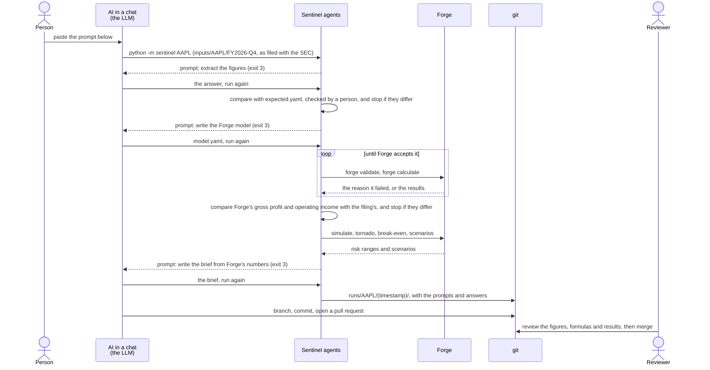

[](https://github.com/mollendorff-ai/sentinel/actions/workflows/ci.yml)
[](https://github.com/mollendorff-ai/sentinel/actions/workflows/ci.yml)
[](https://github.com/mollendorff-ai/sentinel/actions/workflows/ci.yml)
[](pyproject.toml)
[](LICENSE)

# Sentinel

**A demonstration of [Forge](https://github.com/mollendorff-ai/forge) in an AI pipeline. Prototype, built with AI assistance. Not financial advice.**

An AI agent reads a company's quarterly results, writes a Forge model, and Forge validates and calculates it. The agent reads Forge's numbers, never its own arithmetic, and the run's model and results go into git as a pull request for a person to review. It is the fourth workflow of Forge's [docs/WORKFLOWS.md](https://github.com/mollendorff-ai/forge/blob/main/docs/WORKFLOWS.md), the AI pipeline, running for real ([ADR-012](docs/adr/012-sentinel-as-forge-demo.md)).

> **Status (2026-11-15):** 0.9.0. A run happens in an AI chat, and the chat is the LLM, so no API key is needed ([ADR-013](docs/adr/013-run-in-a-chat.md)). Two runs on Apple's Q4 FY2026 filing are in git: the first (`runs/AAPL/20261115-184457/`) and one made after the evaluation of the same day, with a Modeler prompt that gives no formula and the check of Forge's results against the filing (`runs/AAPL/20261115-215223/`, [ADR-014](docs/adr/014-check-the-formulas-and-keep-only-the-demo.md)). A third, on NVIDIA's Q2 FY2027 filing (`runs/NVDA/20261115-230607/`), is the first on a second company and quarter. In CI the whole pipeline runs against the real Forge on the saved filing with a scripted LLM, and a model with a wrong formula fails. **Not shown:** a scheduled run with nobody starting it, and more than two companies.

## How a demo run works



**Three checks, three different questions.** Forge checks the arithmetic: every result comes from a formula it calculated. It cannot tell whether the LLM read the right figure from the filing, so each saved input has an `expected.yaml` of its headline figures, checked by a person, and a run whose extraction differs stops before any model is built. Nor can Forge tell whether a formula is the right one, so `expected.yaml` also holds the subtotals the filing prints (gross profit and operating income), and a run whose Forge results differ stops before any brief is written. A formula with a number in it (`=35631`) fails too, so a result cannot be typed in. The margins are ratios of checked figures and are not compared with the filing.

### A saved input

```text
inputs/AAPL/FY2026-Q4/
  release.htm     the filing as downloaded from SEC EDGAR (checksum in source.yaml)
  release.md      the same document as Markdown (scripts/html_to_markdown.py); what a run reads
  source.yaml     url, filing date, when and how it was saved
  expected.yaml   revenue, cost of revenue, operating expenses, net income; checked: true|false;
                  and results: the gross profit and operating income Forge must calculate
```

`python -m sentinel` refuses to run on an input whose `expected.yaml` says `checked: false`, or that has no `results:`.

### A run

```text
runs/AAPL/<timestamp>/
  raw_data.json           figures the LLM extracted, and the result of the expected.yaml check
  model.yaml              the Forge model the LLM wrote
  forge_results.json      Forge's results, and filing_check: the comparison with the filing's subtotals
  risk_analysis.json      Monte Carlo, tornado and break-even (full mode)
  scenario_analysis.json  bull / base / bear (full mode)
  brief.md                the LLM's brief, written from Forge's results
  llm/                    every prompt Sentinel asked and the answer it got (chat mode)
```

Earlier runs are the history: the Retriever reads `raw_data.json` of earlier periods for the ticker from `runs/`. A failed run is written to `.sentinel/failed/<TICKER>/<timestamp>/` instead, which git ignores, so `runs/` holds only runs that passed every check.

## Agents

| Agent | Role | Tools |
| ----- | ---- | ----- |
| **Research** | Reads the saved release, extracts the quarter's figures, checks them against `expected.yaml` | LLM |
| **Retriever** | Reads earlier periods for the ticker from `runs/` | Files |
| **Modeler** | Writes a Forge model of gross, operating and net margins from a list of fields (the prompt gives no formula), retrying up to 3 times when Forge refuses it; Forge's subtotals must equal the filing's | LLM, Forge validate + calculate (MCP) |
| **Risk Analyst** | Monte Carlo, tornado and break-even on the inputs, built in code (tornado: each input at -10% and +10%; Monte Carlo: each input drawn from a normal distribution whose standard deviation is 10% of its value) | Forge simulate + tornado + break-even (MCP) |
| **Scenario Planner** | Bull / base / bear, built in code (revenue ±10%, probability-weighted) | Forge scenarios + compare (MCP) |
| **Synthesizer** | Writes the brief from Forge's results | LLM |

In `--quick` mode the Risk Analyst and Scenario Planner are skipped. The human review is the pull request.

**Limits:**

- Two saved inputs so far: Apple, fourth quarter of fiscal 2026, and NVIDIA, second quarter of fiscal 2027.
- Risk ranges and scenarios use fixed assumptions applied to one quarter: 10% is a bound in the tornado and the scenarios, and a standard deviation in the Monte Carlo, so about one draw in three falls outside ±10%. They describe those assumptions, not the company's real uncertainty.
- The brief is written by an LLM from Forge's results. Nothing yet checks the text against the numbers.

## Run the demo in a chat

The AI in a chat that can run commands (Claude Code, or a Claude chat with code execution) installs Sentinel and the pinned Forge in its sandbox and plays the LLM: Sentinel writes each LLM prompt to a file and stops, the AI writes the answer and runs Sentinel again. Sentinel's code does everything else, and the run costs nothing beyond the chat ([ADR-013](docs/adr/013-run-in-a-chat.md)).

First, a person checks the figures and the two subtotals in `inputs/AAPL/FY2026-Q4/expected.yaml` against the filing at the url in `source.yaml` and sets `checked: true`. Until then Sentinel refuses to run, unless given `--allow-unchecked` for a test.

Then paste this into the chat:

```text
Run Sentinel, the demonstration of Forge in an AI pipeline
(https://github.com/mollendorff-ai/sentinel), on its saved Apple input.
In this run you are Sentinel's LLM: Sentinel asks you for each LLM step
through files, and does everything else itself.

1. Set it up:
     git clone https://github.com/mollendorff-ai/sentinel.git && cd sentinel
     python3 -m venv .venv && .venv/bin/pip install -q -e .
     scripts/install-forge.sh .venv/bin
   The last line installs the Forge release Sentinel is pinned to and checks
   its checksum. Do not build Forge from source.

2. Run, and repeat while it exits with 3:
     SENTINEL_LLM_PROVIDER=chat PATH="$PWD/.venv/bin:$PATH" .venv/bin/python -m sentinel AAPL
   Each time it exits with 3 it prints a prompt file and an answer file.
   Read the prompt in full, write exactly what it asks for into the answer
   file, and run the same command again. It ends with 0 (done) or 1 (failed;
   the failed run is in .sentinel/failed/: show me why, and commit nothing).

3. Rules for your answers: copy every number from the document or from
   Forge's results in the prompt, never calculate one yourself. Do not edit
   anything in inputs/ or src/, and do not change expected.yaml.

4. When it ends, show me the output of
     .venv/bin/python -m sentinel.summary runs/AAPL/<the new folder>
   and tell me how many times it stopped for an answer.

5. If you can push to the repository, commit only runs/AAPL/<the new folder>
   on a new branch and open a pull request with the summary as its
   description. If not, print every file in that folder, each in its own
   code block with its name.

If you cannot run commands here, say so plainly and do not invent any results.
```

## Run it locally

```bash
git clone https://github.com/mollendorff-ai/sentinel.git && cd sentinel
make setup                                # venv, dependencies, .env (an API key only for a provider other than chat)
scripts/install-forge.sh                  # the pinned Forge, checksum verified (Linux x86_64)
python -m sentinel AAPL                   # the newest saved input; --period FY2026-Q4 for another
SENTINEL_LLM_PROVIDER=chat python -m sentinel AAPL   # no API key: you answer each prompt file
python -m sentinel.summary runs/AAPL/<timestamp>
make check                                # lint + unit tests (100% coverage), no Forge or key needed
make test-integration                     # against the real Forge, no key needed
```

`python -m sentinel` exits with 1 when a run fails (figures that differ from `expected.yaml`, a model Forge refuses, Forge results that differ from the filing's subtotals, no brief), 2 when the input is missing, its `expected.yaml` is not checked, or an API provider has no key, and 3 while a chat-mode prompt waits for its answer.

## Stack

| Layer | Technology |
| ----- | ---------- |
| Orchestration | LangGraph (Python) -- [why Python?](docs/adr/001-python-over-typescript.md) |
| Calculation | [Forge](https://github.com/mollendorff-ai/forge) v10.0.0-rc.26 via MCP, the only calculator, pinned in `scripts/install-forge.sh` |
| LLM in a demo run | the AI in the chat, through prompt and answer files ([ADR-013](docs/adr/013-run-in-a-chat.md)) |
| Record and review | git and a pull request ([ADR-012](docs/adr/012-sentinel-as-forge-demo.md)) |
| LLM outside the demo | Any LangChain-compatible model with its API key -- [swap with one env var](docs/adr/004-multi-provider-llm-support.md) |
| Observability | LangSmith, optional and off by default |

## Roadmap

| Version | Summary | Status |
| ------- | ------- | ------ |
| v0.1.0 to v0.8.1 | Agents, Forge over MCP, risk and scenarios, checkpoints, HITL, MCP server | Shipped |
| v0.9.0 | Forge demo: a saved SEC input checked against `expected.yaml`, Forge's results checked against the filing, no Qdrant, Forge pinned, a run in an AI chat with the chat as the LLM, reviewed as a pull request; `--hitl`, the MCP server and the checkpointer removed ([ADR-014](docs/adr/014-check-the-formulas-and-keep-only-the-demo.md)) | Shipped (2026-11-15) |

Each item, with its acceptance, is in [.asimov/roadmap.yaml](.asimov/roadmap.yaml). History is in the [CHANGELOG](CHANGELOG.md).

## License

[MIT](LICENSE)
